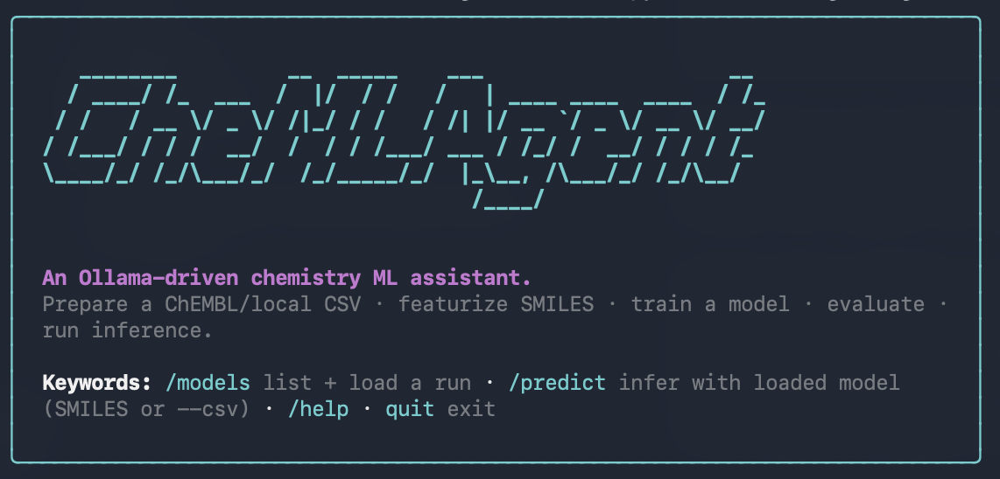

# CheMLAgent



An agentic system for building and training ML models for chemistry (QSAR /
bioactivity / property prediction), driven by **Ollama tool calls**.

A chat model is handed a small set of plain Python functions — discover a
target, prepare a CSV, featurize SMILES, train a model, evaluate it, run
inference — and decides which to call to satisfy a modeling request. Ollama
infers each tool's JSON schema from the function signature + docstring, so the
"agent" is just a thin dispatch loop over real, reusable chemistry code.

## Pipeline

```
[discovery, optional]
  search_targets   (disease → gene symbols)
  search_uniprot   (protein name → UniProt IDs)
  list_bioactives  (UniProt → ChEMBL target ID + counts)
        │
        ▼
prepare_chembl_csv  ──►  featurize_fingerprints  ──►  train_model   ──►  evaluate_model
  (CSV / ChEMBL ID)        (fingerprints /           (RF / LightGBM /      (held-out test)
  ← or input_csv directly   descriptors)              SVR)
        │                       ▲
        └──► prepare_classes ───┘   (optional: turns the run into a
             (target → K equal-       CLASSIFICATION run; every tool
              count classes)          downstream trains/reports classifiers)
                                                   ──►  grid_search        ──►  run_inference(_mlp/_chemprop)
                                                       (5-fold CV over a          (small hyperparameter grid,
                                                        same run_id)               refits + saves best)
                                                   ──►  mlp_scan
                                                       (5-fold-CV scan over a
                                                        SMALL MLP hyperparameter
                                                        grid; refits + saves best)
                                                   ──►  train_mlp
                                                   ──►  train_chemprop
                                                        (MPNN on mol graphs)

featurize_fingerprints  ──►  dimension_reduction   (optional EDA)
                              (PCA / t-SNE 2D projection
                               + scatter plot of the
                               featurized matrix)
                         ──►  cluster_molecules     (optional EDA)
                              (k-means auto-k / HDBSCAN;
                               cluster quality vs target)

compute_distances  (any time; similarity / nearest neighbours,
                    optionally against the run's dataset)
```

The discovery tools are optional — use them when the request gives a protein
name or disease rather than a ChEMBL ID. Once you have a `chembl_id`,
`prepare_chembl_csv` fetches and normalizes the dataset (give it a local
`input_csv` instead to skip discovery and fetch entirely).

State between tool calls lives on disk under `runs/<run_id>/` (fitted models,
featurizers, feature matrices, a `manifest.json`), referenced by path in the
JSON returned to the model — Ollama tool calls exchange JSON, not live objects.
Thread the same `run_id` through every stage of one task.

As each stage completes, its user-facing products (the prepared `data.csv`,
trained model, inference `predictions.csv`, and `manifest.json`) are copied into
`recent_work/<run_id>/` so they're easy to find mid-session. On quit the CLI
**moves** the final products into `recent_work/<run_id>/`, deletes the
intermediate scratch left in `runs/<run_id>/` (feature matrices, lightning
checkpoints, the run dir itself), and prints the absolute paths of the
**runs produced this session only** — runs already in `recent_work/` from
previous sessions are not listed. (The CheMeleon foundation path is
currently inactive — see [CheMeleon foundation model](#chemeleon-foundation-model)
— so no `chemeleon_mp.pt` cache is produced or moved.)

## What it can do

- **Discover a target** — when you only have a protein name or a disease (not a
  ChEMBL ID), `search_targets` lists proteins associated with a disease (Open
  Targets), `search_uniprot` resolves a protein/gene name to UniProt accessions
  (optionally human-only), and `list_bioactives` maps UniProt IDs to ChEMBL
  target IDs with their activity counts so you can pick the richest target.
- **Prepare data** — read a local CSV, or fetch from ChEMBL by target ID
  (either given directly or found via the discovery tools).
  SMILES/target columns are autodetected (handles `SMILES`, `smiles`,
  `canonical_smi`, etc., and `IC50`/`pIC50`/`EC50`/`Ki`/`Kd`/`Lmax`/`λ_max`/
  `potency`/…). A log10 transform is autodetected when the target range is
  ≥ 1000 (e.g. nM IC50); inference inverts it automatically.
- **Classify instead of regress (optional)** — `prepare_classes(run_id,
  num_classes)` bins the target into `num_classes` approximately equal-count
  bands (rows sorted by target, cut every `n // num_classes` rows; default 2 =
  active/inactive), strips common counter-ions (`[Na+]`, `[Cl-]`, `[K+]`,
  `[Br-]`, `[I-]`, `[Ca2+]`) from the SMILES, and writes two columns back to
  `data.csv`: `class` (int 0..K-1) and `class_labels` (range strings like
  `"4.1 < 5.6"`). It sets `task: "classification"` plus `n_classes` /
  `class_labels` in the manifest, and **every downstream tool keys off that
  flag** — `featurize_fingerprints`, `train_model`, `grid_search`, `mlp_scan`,
  `train_mlp`, `train_chemprop`, `evaluate_model` and all three inference tools
  train and report the classifier versions (see the classifier table below).
  Call it **after** `prepare_chembl_csv` and **before** `featurize_fingerprints`
  / `train_chemprop`. The returned `num_classes` is the actual count — it can
  be one fewer than requested if band cutoffs collide on tied target values.
- **Featurize** — fingerprints & descriptors via scikit-fingerprints, then a
  Murcko-scaffold train/test split. 2D types run on the molecular graph; 3D
  types generate conformers first. Pass `fp_type` (case-insensitive) to
  `featurize_fingerprints`.
- **EDA / dimension reduction** — after featurizing, `dimension_reduction`
  projects the featurized matrix to 2D with PCA or t-SNE (optionally dropping
  MCD robust-covariance outliers first — PCA-reduced to ≤50 components on
  high-dim fingerprints so it stays fast) and saves a scatter plot
  (`dim_reduction_<method>_<fp_type>.png`), colored by target value, train/test
  split, or target-derived class. Different fingerprints produce different
  files (keyed by method + fp_type); recoloring overwrites the same projection.
- **EDA / clustering** — `cluster_molecules` groups the featurized molecules
  (train + test, unsupervised; standardized, PCA ≤ 50 comps for k-means, ≤ 10 for HDBSCAN) with **k-means**
  (`n_clusters=0` → k at the inertia elbow over 2..`max_clusters`) or
  **HDBSCAN** (finds its own clusters; low-density molecules → noise `-1`).
  Clusters are scored against the target as in Toney et al. (Chem. Sci. 2026):
  `u_test_frac` (fraction of cluster pairs with significantly different target
  distributions, Mann–Whitney p < 0.05), Davies–Bouldin and Calinski–Harabasz
  indices on the target, plus feature-space silhouette. Writes
  `clusters_<method>_<fp_type>.csv` (SMILES, split, target, cluster); then
  `dimension_reduction(color_by='clusters')` plots them.
- **Similarity / distances** — `compute_distances` gives distances in [0, 1]
  (similarity = 1 − distance) from query SMILES to `reference_smiles`, to the
  run's whole dataset (`against_dataset=True`: each query's nearest dataset
  molecules with their targets — a quick applicability-domain check before
  trusting a prediction), or among the queries. Ported from CafChem's
  `get_distances` (`fingerprints.get_distances`) and extended:

  | `distance_type` | measure | cost |
  |-----------------|---------|------|
  | `tanimoto` (default) | Tanimoto on any `fp_type` (`fp_type=`, default `ECFP`: Morgan bits, r = 2, 2048); continuous descriptors min-max scaled per column over the molecules compared | fast (2D types) |
  | `spectral_2d`   | spectral fingerprint (bond paths), e/(1+e) of Euclidean e | fast |
  | `spectral`      | spectral fingerprint (3D conformers) | conformer generation |
  | `mcs`           | 1 − maximum-common-substructure similarity (10 s/pair timeout) | ~50 ms/pair, ≤ 50k pairs |
  | `fraggle`       | 1 − Fraggle similarity | ~60 ms/pair, ≤ 50k pairs |

  Fraggle (skfp/RDKit) fragments the *query* molecule and cannot score any
  pair whose query has an acridine-type core (three linearly fused
  six-membered rings around a ring N — acridine, tacrine and its hybrids;
  ~14% of CHEMBL220, none of azo), even against itself; such references are
  scored normally. Failed pairs get distance 1.0 and are counted in
  `n_failed_pairs`. Other fused systems (naphthalene, indole, quinoline,
  carbazole, steroids) score normally.

  The `fp_type` values accepted by `featurize_fingerprints` (and thus by
  `dimension_reduction`):

  | fp_type            | kind           | description                                                                  |
  |--------------------|----------------|------------------------------------------------------------------------------|
  | `ECFP`             | fingerprint    | Morgan/ECFP circular fingerprint (counted)                                   |
  | `Atom_Pair`        | fingerprint    | topological atom-pair fingerprint                                            |
  | `MACCS`            | fingerprint    | 166-bit MACCS structural keys                                                |
  | `PubChem`          | fingerprint    | PubChem 881-bit fingerprint                                                  |
  | `Functional_Groups`| fingerprint    | functional-group presence bits                                               |
  | `RDKitFingerprint` | fingerprint    | RDKit path fingerprint                                                       |
  | `Mordred`          | descriptor     | Mordred 2D/3D descriptor set (NaNs imputed downstream)                       |
  | `RDKit_2D`         | descriptor     | RDKit's native ~217 continuous 2D descriptors                                |
  | `EState`           | descriptor     | 79 Kier–Hall electrotopological-state descriptors                            |
  | `E3FP`             | 3D fingerprint | 3D fingerprint from generated conformers                                     |
  | `Autocorr`         | 3D descriptor  | 3D autocorrelation descriptors                                               |
  | `MORSE`            | 3D descriptor  | 3D Molecule Representation of Structures based on Electron diffraction      |
  | `RDF`              | 3D descriptor  | radial distribution function descriptors                                     |
  | `Spectral`         | 3D descriptor  | spectral graph-Laplacian eigenvalues from generated conformers               |
  | `Spectral_2D`      | descriptor     | spectral graph-Laplacian fingerprint using bond-path distances                |

  **3D types and conformers.** Conformers (5 per molecule, UFF-minimized,
  lowest energy kept) are generated in parallel batches with a 10 s RDKit
  embedding limit. A molecule RDKit cannot embed (rare — 5 of ~6,000 in
  CHEMBL220, e.g. strained cages) is dropped with its target and listed in the
  manifest (`dropped_no_conformer`) instead of aborting the run; without the
  limit each such molecule took up to 22 min to fail. Conformers are cached on
  the featurizer object, so further splits or 3D types on the same data reuse
  them (~14 min for 6k molecules the first time, seconds after).
  | *(molecular graph)*| graph          | not an `fp_type` — `train_chemprop` builds the graph directly from `data.csv` (SMILES → atom/bond graph via chemprop) |

- **Train** — pick one model per run (same `run_id`). Fingerprint/descriptor
  models take the featurized matrix; Chemprop reads `data.csv` directly and
  trains on molecular graphs (no `featurize_fingerprints` call needed).

  | tool              | model                          | input              | notes                                                   |
  |-------------------|--------------------------------|--------------------|---------------------------------------------------------|
  | `train_model`     | Random Forest                  | fingerprints/descriptors | `model_type=random_forest`, `n_estimators` tunable |
  | `train_model`     | LightGBM                       | fingerprints/descriptors | `model_type=lightgbm`                               |
  | `train_model`     | SVR                            | fingerprints/descriptors | `model_type=svr`, literature-tuned poly kernel     |
  | `train_model`     | Gaussian process               | fingerprints/descriptors | `model_type=gp`, regression only; Tanimoto kernel on fingerprints, RBF on descriptors; inference adds a 95% interval (see below) |
  | `grid_search`     | RF / LightGBM / SVR            | fingerprints/descriptors | 5-fold CV over a small grid; refits + saves best (see below) |
  | `mlp_scan`        | PyTorch wide-and-deep MLP      | fingerprints      | 5-fold-CV scan over a SMALL grid; refits + saves best (see below) |
  | `train_mlp`       | PyTorch wide-and-deep MLP      | fingerprints      | SGD/lr/weight-decay/batch tuned internally             |
  | `train_chemprop`  | Chemprop MPNN                  | molecular graphs  | from-scratch MPNN only (CheMeleon foundation wired but inactive — see below) |

  On a **classification run** (after `prepare_classes`) the same tools swap in
  the classifier counterpart automatically — no different tool names or
  arguments:

  | tool / `model_type`          | classifier used                                                    |
  |------------------------------|--------------------------------------------------------------------|
  | `train_model` `random_forest`| `RandomForestClassifier`                                           |
  | `train_model` `lightgbm`     | `LGBMClassifier` (`n_jobs=1`, libomp)                              |
  | `train_model` `svr`          | poly-kernel `SVC` (C=2, degree=3, coef0=2) in the same impute → scale pipeline |
  | `train_model` `gp`           | not supported — raises an error; use one of the classifiers above  |
  | `grid_search`                | the three classifiers above, CV-scored on accuracy                 |
  | `train_mlp` / `mlp_scan`     | same wide-and-deep MLP with a K-way LogSoftmax head (NLL loss), argmax at inference |
  | `train_chemprop`             | MPNN with a `MulticlassClassificationFFN` head (cross-entropy)     |

- **Evaluate & infer** — metrics on the held-out split; predictions for new
  SMILES in original units. Classification runs report **accuracy, balanced
  accuracy, MCC, macro-F1 and a row-normalized confusion matrix** instead of
  R²/MAE, and inference returns `predicted_class` (int indices) plus
  `predicted_labels` (the range strings) with no log inversion.

## Requirements

- **Python 3.14** (pinned in `pyproject.toml`). The cp312 torch wheel segfaults
  inside chemprop/lightning training; the cp314 wheel trains on Apple MPS
  without issue, so the project requires 3.14.
- [uv](https://docs.astral.sh/uv/) for environment management.
- An Ollama endpoint (cloud or local) with a chat model that supports tool
  calls, e.g. `glm-5.2`, `gemma3:27b`, `qwen2.5`.

## Install

Clone from GitHub, then create the environment and sync:

```bash
git clone https://github.com/MauricioCafiero/CheMLAgent.git
cd CheMLAgent
uv venv --python 3.14
uv sync --all-extras      # base + mlp + chemprop + chembl
# or pick extras:  uv sync --extra mlp --extra chemprop --extra chembl
```

Extras:

| extra       | brings in                              |
|-------------|----------------------------------------|
| `mlp`       | torch, matplotlib (PyTorch MLP)        |
| `chemprop`  | chemprop, lightning, torch (MPNN)      |
| `chembl`    | chembl_webresource_client (ChEMBL fetch)|
| `all`       | all of the above                       |
| `dev`       | pytest                                 |

Configure the Ollama client via environment variables:

```bash
export OLLAMA_HOST=https://ollama.com   # or http://localhost:11434 for local
export OLLAMA_API_KEY=...               # only if your host requires it
```

## Usage

Interactive REPL:

```bash
uv run python -m chemlagent.agent --print --model glm-5.2
```

`--print` shows the model's thinking, tool calls, and results; `--model` selects
the chat model (defaults to the first of `DEFAULT_MODELS` in `agent.py`).

### REPL keywords

The REPL also takes deterministic keywords that skip the chat model and act
directly on saved runs (the banner lists these at startup):

| keyword                                       | action                                            |
|-----------------------------------------------|---------------------------------------------------|
| `quit` / `exit`                               | exit; move products to `recent_work/`, print paths |
| `/models`                                     | list saved runs, then pick one (row number or `run_id`) to load |
| `/predict <SMILES ...>`                       | inference for inline SMILES with the loaded model |
| `/predict --csv <f> [--smiles-col C] [--out o.csv]` | batch: load SMILES from a CSV, predict with the loaded model |
| `/predict <run_id> <SMILES ...>`              | load that run, then predict (becomes the loaded model) |
| `/help`                                       | show the keywords                                 |

The flow is **load-then-predict**: `/models` lists the saved runs in
`recent_work/` and loads the one you pick; it stays loaded (the prompt shows
`[run_id]` when one is active) so later `/predict` calls reuse it with inline
SMILES or `--csv` — no `run_id` needed. `/predict <run_id> …` loads a run and
predicts in one step. These reuse the deterministic reload code
(`chemlagent.reload`), so no Ollama call is involved. Anything that isn't a
keyword is sent to the model as your request.

### Example prompt

> Build a QSAR model for the human MAO-B protein. I don't have a ChEMBL ID —
> discover one: search UniProt for `MAOB` (human only), then list the bioactives
> to find the ChEMBL target with the most IC50s. Prepare a 600-row dataset
> (`run_id=maob`), featurize with ECFP, and train a random forest. Report the
> ChEMBL ID and test R².

This drives the full discovery → prepare → featurize → train chain. On a live
run it resolves MAO-B → UniProt P27338 → CHEMBL2039 (5,751 IC50s), trains on 600
rows, and reports R² ≈ 0.18 on the held-out scaffold split (overfits at 600
rows; `limit=0` for all 5,751 generalizes better).

Or, with a local CSV (no discovery / fetch):

> Use the local CSV `621-azo.csv` (SMILES column `SMILES`, target column `Lmax`).
> Prepare it with `run_id=azo`, train a chemprop model (`epochs=15`),
> then predict λ_max for `c1ccc(/N=N/c2ccccc2)cc1` and
> `C[N]1N=NC(=N1)N=NC2=CC=CC=C2`. Report test R², MAE, and the predictions in nm.

On the azo dataset this yields ~R² 0.90, ~MAE 15 nm, and predicts azobenzene at
~320 nm (matching its experimental π→π\* band). *(These numbers were observed
when the CheMeleon foundation path was still active; with the from-scratch
MPNN that `train_chemprop` now uses, expect somewhat lower R² at the same
epoch count.)*

Or, as a classifier:

> Use the local CSV `CHEMBL220_bioactives.csv`. Prepare it with
> `run_id=ache_cls`, then split the target into 3 classes. Featurize with ECFP,
> train a random forest classifier, and report accuracy, MCC and the class
> ranges. Then predict the class of `CCOc1ccc(cc1)C(=O)NC`.

The agent calls `prepare_chembl_csv → prepare_classes(num_classes=3) →
featurize_fingerprints → train_model → evaluate_model → run_inference`; the
prediction comes back as a class index and its range label.

## Tools

Each is a plain function in `src/chemlagent/tools.py` with a numpydoc docstring
that doubles as the Ollama tool schema.

| tool                     | args (besides `run_id`)                                   |
|--------------------------|-----------------------------------------------------------|
| `search_targets`         | `disease_names`                                           |
| `search_uniprot`         | `protein_names`; `human_only` (default `False`)           |
| `list_bioactives`        | `uniprot_ids`; `activity_type` (default `IC50`)           |
| `prepare_chembl_csv`     | `chembl_id` *or* `input_csv`; `limit`, `units`, `activity_type` |
| `prepare_classes`        | `num_classes` (default 2) — optional; makes the run a classification run |
| `featurize_fingerprints` | `fp_type` (default `ECFP`), `test_size`                   |
| `train_model`            | `model_type` (`random_forest`/`lightgbm`/`svr`/`gp`), `n_estimators` |
| `grid_search`            | `model_type`, `param_grid` (dict; capped at 3 values/param, 6 combos total) |
| `mlp_scan`               | `param_grid` (dict; capped at 3 values/param, 6 combos total), `cv_folds` (default 5) |
| `dimension_reduction`    | `method` (`pca`/`tsne`), `color_by` (`target`/`split`/`classes`/`clusters`), `num_classes`, `remove_outliers` |
| `cluster_molecules`      | `method` (`kmeans`/`hdbscan`), `n_clusters` (0 = auto), `max_clusters`, `min_cluster_size` (0 = auto) |
| `compute_distances`      | `smiles_list`, `distance_type`, `fp_type` (tanimoto), `reference_smiles`, `against_dataset`, `top_k` |
| `evaluate_model`         | —                                                         |
| `run_inference`          | `smiles_list`                                             |
| `train_mlp`              | `epochs` (default 2500, the tuned value)                  |
| `run_inference_mlp`      | `smiles_list`                                             |
| `train_chemprop`         | `epochs` (default 30), `batch_size`, `accelerator`       |
| `run_inference_chemprop` | `smiles_list`                                             |
| `shell`                  | `command` — sandboxed cross-platform mini-shell (`pwd`, `cd`, `ls`, `mkdir`, `find`, `cat`, `head`, `tail`, `wc`, `grep`); lives in `src/chemlagent/shell.py`. Lets the agent discover existing CSVs and per-run artifacts (under `runs/` and `recent_work/`) before creating anything new. No real shell is spawned; access is jailed to the repo, and there is no `rm`/`mv`/`cp` |

### Gaussian process (`model_type=gp`)

`models.gaussian_process_regression` picks its kernel from the features:
a **Tanimoto** kernel on fingerprint bits/counts (ECFP, Atom_Pair, MACCS, ...)
or an **RBF** kernel on continuous descriptors (RDKit_2D, Mordred, ...) after
the SVR's impute → standardize step. Amplitude, noise (and RBF length scale)
are fit by marginal likelihood, so there is nothing to tune. `run_inference`
returns `lower95` / `upper95` bounds per molecule (also written to
`predictions.csv`), back-transformed to original units on log-target runs.

Benchmark (`experiments/gp_vs_rf.py`, 5 scaffold splits, test R², mean ± sd):

| dataset                 | RF + RDKit_2D | RF + ECFP   | GP + RDKit_2D | GP + ECFP (Tanimoto) |
|-------------------------|---------------|-------------|---------------|----------------------|
| CHEMBL220 (log IC50)    | 0.500 ± 0.02  | 0.546 ± 0.05| 0.501 ± 0.04  | **0.612 ± 0.06**     |
| 621-azo (Lmax)          | 0.710 ± 0.13  | 0.616 ± 0.14| 0.700 ± 0.12  | **0.719 ± 0.10**     |

GP + ECFP beat RF + ECFP on all 10 splits and the best RF on all 5 CHEMBL220
splits; on the small azo set it ties the best RF. The 95% intervals cover
91–93% of test values (slightly over-confident), and the predicted std is only
weakly rank-correlated with the actual error (Spearman 0.10–0.30). Exact GP
cost is O(n³): a ~4800-molecule fit takes ~20 s; expect it to get slow past
~10–15k molecules.

Arguments are deliberately minimal to keep tool calls well-formed. Hyperparameters
that aren't exposed use tuned internal defaults (e.g. the SVR poly kernel, the
MLP's SGD/lr/weight-decay/batch config, chemprop's Noam-style LR schedule).

`grid_search` is the exception: it exposes a bounded hyperparameter grid. The
search runs 5-fold CV on the **train split only** (the held-out test split is
never seen during tuning), refits the best combination on the full train set,
and saves the result like `train_model` so `evaluate_model`/`run_inference`
work unchanged. The grid is capped at 3 values per hyperparameter and 6
combinations total (a 3×3=9 grid is rejected), runs single-threaded to avoid
the Apple-Silicon libomp double-load segfault, and only whitelisted params are
accepted: `random_forest` {n_estimators, max_depth, min_samples_leaf,
max_features}, `lightgbm` {n_estimators, num_leaves, learning_rate,
min_child_samples}, `svr` {C, gamma, epsilon} (the poly kernel's degree=2 /
coef0=7 stay fixed). Chemprop is not yet covered by any scan tool. On a
classification run the `svr` grid targets the SVC instead (degree=3 / coef0=2
fixed), so only `C` and `gamma` apply — `epsilon` is an SVR-only parameter.

`mlp_scan` is the MLP counterpart: it exposes a bounded grid of MLP
hyperparameters (`neurons`, `num_hidden_layers`, `lr`, `weight_decay`,
`pca_var`; `epochs` is deliberately NOT searched — a decent max + early
stopping already handles it). It runs 5-fold CV on the **train split only**,
refits the best combination on the full train set, scores on the held-out test
split, and saves `model_mlp.pt` + `mlp_prep.npz` + `mlp_arch` exactly like
`train_mlp`, so `evaluate_model(run_id, 'mlp')` / `run_inference_mlp` work
unchanged. Same caps as `grid_search` (3 values/param, 6 combos total),
single-threaded, and omitted params fall back to tuned defaults (neurons 250,
1 hidden layer, lr 2e-3, weight_decay 0.2, pca_var 0.95) — so a partial grid
scans a subset. If every combination's SGD diverges, it raises with a hint to
lower `lr` / `weight_decay`.

### CheMeleon foundation model

`train_chemprop` is wired to initialize its message-passing block from the
[CheMeleon](https://arxiv.org/abs/2506.15792) pretrained weights (downloaded
once to `runs/chemeleon_mp.pt`) and fine-tune a fresh regression head —
transfer learning that converges in a few epochs. **This path is currently
inactive, however.** The pretrained message-passer is large (`d_h=2048`,
`depth=6`, ~8.7M parameters) and blows up memory on this machine, so on
2026-07-24 the `foundation` argument was removed from `train_chemprop` and it
now trains only chemprop's standard from-scratch MPNN (`d_h=300`, `depth=3`,
~30× smaller). The foundation loading machinery
(`chemprop_model._load_foundation_mp`, the `from_foundation` / `foundation_path`
constructor path, and the `_FOUNDATION_CACHE = runs/chemeleon_mp.pt` constant
in `tools.py`) is preserved intact so the path can be re-enabled later by
re-adding a `foundation` flag that branches to `chemprop_model(from_foundation="chemeleon", foundation_path=_FOUNDATION_CACHE)`. Until then, no
`chemeleon_mp.pt` cache is downloaded or written, and the manifest's
`is_foundation` is always `False`.

## Where input CSVs come from

`prepare_chembl_csv` takes a path in its `input_csv` argument and reads it
**as given, relative to your current working directory** (it does not search
anywhere). When you launch the agent from the project root —
`uv run python -m chemlagent.agent` — that CWD *is* the repo root, so a CSV
dropped there (e.g. the bundled `621-azo.csv`, `CHEMBL220_bioactives.csv`) is
reachable by bare filename: `input_csv="621-azo.csv"`. Absolute paths work too,
for CSVs living elsewhere. If `input_csv` is omitted, pass a `chembl_id` to
fetch from ChEMBL instead.

## What an inference call needs

Inference needs **only a `run_id` plus a list of SMILES strings — no CSV**.
The model + featurizer (and, for the MLP, the preprocessing stats) are reloaded
from the saved run artifacts, the new SMILES are featurized, and predictions
come back in original units with any log transform inverted. The SMILES are
whatever you type in the prompt (e.g. *"predict for c1ccc(/N=N/c2ccccc2)cc1
and CC(=O)Oc1ccccc1C(=O)O"*); there is no agent tool that reads a CSV of
SMILES for batch inference. For batch prediction from a CSV, use the
deterministic reload CLI below (`predict --csv`).

## Reloading saved models (deterministic, no Ollama)

`src/chemlagent/reload.py` lets you reuse a run's products straight from
`recent_work/<run_id>/` without going through the agent. It dispatches on the
manifest's `model_type` (random_forest / lightgbm / svr / gp / mlp / chemprop) and
applies the manifest's log-transform inversion, so predictions are in original
units.

```bash
# list every saved run with its metrics
uv run python -m chemlagent.reload list

# predict for SMILES given on the command line
uv run python -m chemlagent.reload predict azo "c1ccc(/N=N/c2ccccc2)cc1"

# batch: read SMILES from a CSV, write predictions to a CSV
uv run python -m chemlagent.reload predict azo \
    --csv 621-azo.csv --smiles-col SMILES --out preds.csv
```

Paths resolve from `recent_work/<run_id>/` by the known filenames for each
model type, so it works whether or not the manifest's path fields were
rewritten at quit.

Classification runs are handled too: the reloader reads the manifest's
`task` (per model, so a run holding both kinds dispatches correctly) and
returns `predicted_class` + `predicted_label` columns with no log inversion,
building the MLP's K-way head and chemprop's multiclass head as needed. `list`
(and `/models`) show a `task` column and `accuracy` alongside `r2`/`mae`.

## Project layout

```
src/chemlagent/
  agent.py              Ollama dispatch loop + CLI
  tools.py              16 Ollama-callable tool functions (3 discovery + 13 pipeline)
  shell.py              the sandboxed `shell` tool (17th tool)
  data.py               CSV prep (local + ChEMBL), column/log autodetect
  fingerprints.py       scikit-fingerprints wrappers + scaffold split
  classify.py           prepare_classes binning, counter-ion stripping, classification metrics
  models.py             RF / LightGBM / SVR / GP regressors + RF / LightGBM / SVC classifiers + evaluate
  pytorch_mlp.py        wide-and-deep PyTorch MLP
  chemprop_model.py     Chemprop MPNN data + model classes
  descriptor_cleaning.py  impute / aggressive feature cleaners
  products.py            publish products to recent_work/ + list them on quit
  reload.py              deterministic model reload + inference from recent_work/
tests/                  pytest suite on real ChEMBL data (see Tests)
runs/<run_id>/          working run artifacts (gitignored, regenerable)
recent_work/<run_id>/   curated products copied out as stages complete (gitignored)
```

## Tests

```bash
uv run pytest
```

The whole suite runs on **real data** without hitting Ollama: `conftest.py`
featurizes a 200-row ECFP slice of the bundled `CHEMBL220_bioactives.csv` once
per test module, from a tmp CWD so `runs/` and `recent_work/` stay isolated
(tests skip if the CSV is missing). Slow models are tested too, with shrunk
configs (1-epoch CPU chemprop, short MLP runs) rather than excluded.

| file                                | covers                                                     |
|-------------------------------------|------------------------------------------------------------|
| `test_smoke.py`                     | `prepare → featurize → train (RF) → evaluate` round trip   |
| `test_grid_search.py`               | bounded-CV `grid_search`                                   |
| `test_mlp_scan.py`                  | bounded-CV `mlp_scan`                                      |
| `test_dimension_reduction.py`       | PCA / t-SNE EDA projection                                 |
| `test_clustering.py`                | k-means / HDBSCAN on known blobs; `cluster_molecules` + cluster-colored plot |
| `test_distances.py`                 | all distance types, tanimoto across fp_types; Fraggle failure handling; `compute_distances` modes |
| `test_spectral_fp.py`               | spectral fingerprint invariances; `Spectral` / `Spectral_2D` pipeline round trips |
| `test_multi_model.py`               | several model types on one run                             |
| `test_classification_real_data.py`  | `prepare_classes` + RF / SVC / LightGBM grid / MLP / `mlp_scan` classifier round trips |
| `test_chemprop.py`                  | chemprop regression **and** classifier: train → evaluate → inference |
| `test_shell.py`                     | the sandboxed `shell` tool                                 |

`tests/cls_e2e_check.py` is a manual (non-pytest) end-to-end script for the
classifier pipeline, run directly with `uv run python tests/cls_e2e_check.py`.

## Notes

- **torch before lightgbm import order.** `tools.py` imports `torch` (guarded)
  before `chemlagent.fingerprints`/`chemlagent.models`. On Apple Silicon both
  torch and lightgbm bundle OpenMP; if lightgbm's loads first, torch ops
  segfault. Don't reorder those imports.
- Hyperparameter scans are bounded for the LLM-driven agent: `grid_search`
  (RF/LightGBM/SVR) and `mlp_scan` (MLP) cap at 3 values per hyperparameter and
  6 combinations total, single-threaded. chemprop MPNN is not yet covered.
- `CLAUDE.md` holds the original project brief / agent instructions.

## Acknowledgments

CheMLAgent is a thin agentic layer on top of several excellent open-source
projects; the real chemistry and ML heavy lifting is theirs:

| package                                              | used for                                  |
|------------------------------------------------------|-------------------------------------------|
| [RDKit](https://www.rdkit.org/)                      | SMILES parsing, descriptors, Murcko scaffolds, conformer generation |
| [scikit-fingerprints](https://github.com/dfpl/scikit-fingerprints) | the fingerprint/descriptor estimators behind `featurize_fingerprints` |
| [scikit-learn](https://scikit-learn.org/)            | Random Forest, SVR, Gaussian process, PCA, StandardScaler, metrics |
| [LightGBM](https://lightgbm.readthedocs.io/)         | gradient-boosted trees model               |
| [PyTorch](https://pytorch.org/)                      | the wide-and-deep MLP                     |
| [Chemprop](https://chemprop.org/)                   | message-passing neural network for molecular graphs |
| [Lightning](https://lightning.ai/)                  | Chemprop's training loop                   |
| [CheMeleon](https://arxiv.org/abs/2506.15792)        | pretrained MPNN foundation weights (wired in `chemprop_model` but currently inactive in `train_chemprop` due to memory — see above) |
| [ChEMBL](https://www.ebi.ac.uk/chembl/) + `chembl_webresource_client` | bioactivity data and the `chembl_id` fetch mode |
| [Open Targets](https://www.opentargets.org/)        | disease → target associations (`search_targets`) |
| [UniProt](https://www.uniprot.org/)                 | protein/gene → accession resolution (`search_uniprot`) |
| [Ollama](https://ollama.com/)                       | chat model + tool-call dispatch           |
| [Rich](https://rich.readthedocs.io/)                | terminal UI (banners, tables, Markdown rendering) |
| [pandas](https://pandas.pydata.org/) / [NumPy](https://numpy.org/) | tabular I/O and array math       |
| [uv](https://docs.astral.sh/uv/) / [pytest](https://docs.pytest.org/) | environment management / tests     |

Data fetched via ChEMBL, Open Targets, and UniProt is governed by their
respective licenses and terms of use.